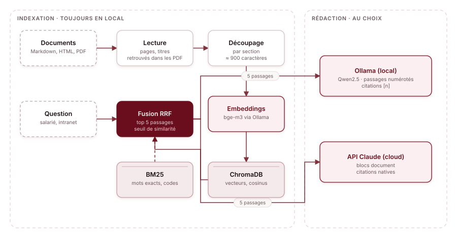

# Falak Docs

Un assistant qui répond aux questions des salariés à partir des documents de
l'entreprise, et qui cite ses sources. Les documents sont indexés en local ; la
réponse peut être rédigée par un LLM local (Ollama) ou par l'API Claude, au
choix, sans rien changer au reste de la chaîne.



Le document complet est dans [docs/falak-docs.pdf](docs/falak-docs.pdf).

## Ce que le projet montre

- **Une chaîne RAG complète** : lecture de Markdown, HTML et PDF (avec numéros
  de page), découpage qui respecte la structure, embeddings, index vectoriel
  ChromaDB, génération avec citations.
- **Une recherche hybride.** Les vecteurs retrouvent les reformulations, BM25
  retrouve ce qui ne se reformule pas (« L133-3 », « B100 », un code d'erreur).
  Les deux listes sont fusionnées par rang (Reciprocal Rank Fusion).
- **Local ou cloud, au choix.** Les embeddings restent toujours sur la machine.
  Pour la génération, `ollama` garde tout en interne ; `claude` envoie
  seulement les quelques passages retenus à l'API Anthropic, qui rattache
  elle-même chaque phrase de la réponse au passage qui la justifie.
- **Savoir ne pas répondre.** Si aucun passage n'est assez proche de la
  question, le modèle n'est pas appelé du tout : la réponse est « je ne trouve
  pas », pas une invention plausible.
- **Mesurer.** `falak-docs eval` calcule hit@k et MRR sur un jeu de questions
  annotées, puis vérifie les réponses avec `--answers`.

## Démarrage

```bash
pip install -e .
ollama pull bge-m3
ollama pull qwen2.5:7b-instruct-q4_K_S

falak-docs ingest corpus/
falak-docs ask "Sous combien de jours faut-il confirmer des réserves ?"
```

```
Les réserves doivent être confirmées par lettre recommandée dans les 3 jours
ouvrés suivant la livraison [1].
  [1] Conditions générales de transport — Réclamations > Avaries et manquants
```

Avec l'API Claude pour la rédaction :

```bash
export ANTHROPIC_API_KEY=...
falak-docs ask --provider claude "Puis-je brancher ma clé USB sur mon poste ?"
```

Le modèle par défaut est `claude-opus-5-5` (réglable avec
`FALAKDOCS_CLAUDE_MODEL`). Le repli côté serveur (`fallbacks`) est activé :
si un filtre de sécurité refuse une requête, l'API la rejoue sur un autre
modèle au lieu de renvoyer une réponse vide.

API HTTP : `falak-docs serve`, puis `POST /v1/ask` avec l'en-tête `X-API-Key`.
La réponse contient le texte, les citations numérotées et les passages
retrouvés avec leurs scores.

## Corpus de démonstration

`corpus/` contient cinq documents d'une entreprise fictive, Transports
Delorme, dans trois formats : conditions générales de transport, procédure de
sécurité d'entrepôt, guide d'accueil (Markdown), charte informatique (PDF de
deux pages) et rapport RSE (page HTML).

## Évaluation

```bash
falak-docs eval                        # recherche seule, sans LLM
falak-docs eval --answers              # + vérification des réponses
falak-docs eval --answers --provider claude
```

Les deux dernières questions du jeu n'ont pas de réponse dans le corpus : le
test réussit si l'assistant dit qu'il ne sait pas.

## Structure

```
src/falakdocs/
  loaders.py     lecture Markdown, HTML, PDF
  chunking.py    découpage par sections et paragraphes
  embeddings.py  embeddings Ollama (bge-m3)
  bm25.py        recherche par mots-clés
  store.py       index ChromaDB
  retrieval.py   recherche hybride et fusion par rang
  generation.py  réponse via Ollama ou Claude, avec citations
  pipeline.py    ingestion et questions
  evaluate.py    hit@k, MRR, contrôle des réponses
  api.py, cli.py
```

## Tests

```bash
pip install -e ".[dev]"
pytest
```

Les tests n'appellent aucun modèle : un embedder déterministe remplace
bge-m3, et les API Ollama et Anthropic sont simulées au niveau HTTP, ce qui
vérifie aussi la forme exacte des requêtes envoyées.

## Licence

MIT
